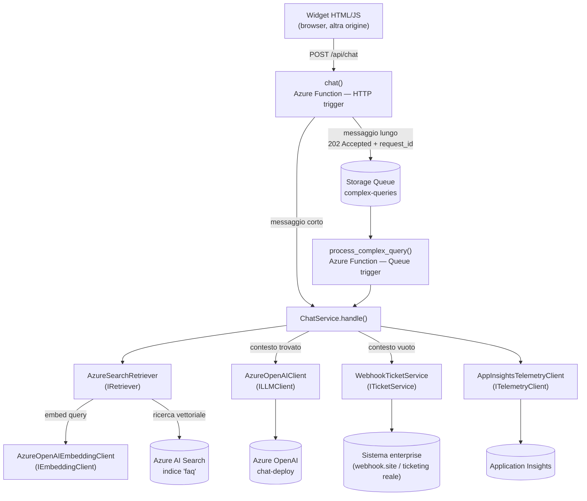

# Architettura del progetto e Glossario di ripasso

> Documento di sintesi, pensato per il ripasso pre-colloquio. Le guide `fase0`→`fase6` spiegano *come* costruire ogni pezzo passo-passo; questo file spiega *come tutto si tiene insieme* e raccoglie i termini che devi saper spiegare a voce, con definizioni brevi.

---

## 1. Cosa fa questo progetto, in una frase

Un chatbot di supporto tecnico su Azure Functions (Python) che risponde usando RAG (Azure AI Search + Azure OpenAI), traccia tutto su Application Insights, smista le richieste pesanti su una coda asincrona, ed escala a un ticket quando non trova informazioni sufficienti — invece di inventare una risposta.

## 2. Diagramma del flusso



Tre percorsi che convergono tutti sullo stesso `ChatService.handle()`, che non sa da dove viene stata chiamata (HTTP diretto o coda) né dove va a finire la risposta (utente diretto o polling):

1. **Sincrono normale**: widget → `chat()` → `ChatService` → retrieval + generazione → risposta `200`.
2. **Asincrono**: messaggio lungo → `chat()` pubblica su coda, risponde subito `202` → `process_complex_query()` la consuma in background → stessa `ChatService`.
3. **Escalation**: se il retriever non trova nulla di rilevante → `ChatService` apre un ticket invece di chiamare l'LLM a vuoto.

## 3. I livelli dell'architettura

```
domain/           →  Solo contratti (interfacce). Zero dipendenze da Azure, zero logica.
services/         →  Logica di business (ChatService). Dipende solo da domain/.
infrastructure/   →  Implementazioni concrete (Azure OpenAI, Azure AI Search, ecc). Dipendono da domain/.
function_app.py   →  "Composition root": assembla le implementazioni concrete e le inietta nel service.
widget/           →  Frontend statico, parla solo via HTTP con function_app.py.
knowledge-base/   →  Contenuto (le FAQ), non codice — l'input della pipeline RAG.
```

Regola che vale ovunque nel progetto: **le frecce delle dipendenze puntano sempre verso `domain/`**, mai verso `infrastructure/`. `ChatService` non ha mai un `import` che punta a un file dentro `infrastructure/`.

| File in `domain/interfaces.py` | Cosa astrae | Implementazione concreta in `infrastructure/` |
|---|---|---|
| `ILLMClient` | generare una risposta testuale | `AzureOpenAIClient` |
| `IEmbeddingClient` | trasformare testo in vettore | `AzureOpenAIEmbeddingClient` |
| `IRetriever` | recuperare contesto pertinente | `AzureSearchRetriever` |
| `ITelemetryClient` | tracciare eventi/eccezioni | `AppInsightsTelemetryClient` |
| `IQueuePublisher` | instradare lavoro asincrono | `AzureQueuePublisher` |
| `ITicketService` | aprire un ticket di escalation | `WebhookTicketService` |

Cinque interfacce, stesso schema ripetuto sei volte: è il punto da sottolineare al colloquio — non è un'idea applicata una volta per caso, è una **decisione architetturale consapevole e coerente**.

## 4. Percorso di una richiesta, passo passo — ogni riga spiegata, in sequenza

### Sintassi Python che userai in tutta questa sezione (leggi prima questo blocco)

- `self` = "questo oggetto specifico". Dentro un metodo di una classe, `self._client` significa "il client che appartiene a *questa* istanza".
- `nome: tipo` (es. `query: str`) è un **type hint**: documenta il tipo atteso, senza forzarlo davvero a runtime.
- `-> tipo` dopo la firma di una funzione dice cosa **ritorna**.
- `@qualcosa` sopra una funzione è un **decoratore**: una funzione che "avvolge" quella sotto per aggiungerle comportamento, senza che tu debba scriverlo dentro. `@app.route(...)` dice al runtime di Azure Functions "collega questa funzione a una richiesta HTTP" — non lo scrivi tu, lo fa il decoratore.
- `oggetto.metodo(arg=valore)` chiama un metodo passando un argomento **con nome** (keyword argument), più leggibile che per posizione.
- `dizionario.get("chiave", default)` legge un valore da un dizionario; se la chiave non c'è, ritorna `default` invece di sollevare un errore.
- `f"testo {variabile}"` è una **f-string**: stringa con variabili incorporate direttamente tra parentesi graffe.
- `[qualcosa for x in lista if condizione]` è una **list comprehension**: costruisce una nuova lista, un pezzo per ogni elemento, scartando quelli che non passano il `if`.
- `try / except / raise`: prova a eseguire del codice; se lancia un errore, lo `except` lo intercetta; `raise` dentro l'`except` **rilancia** lo stesso errore dopo averlo gestito (qui: dopo averlo loggato), invece di nasconderlo.

---

### Passo 1 — il browser invia la richiesta

Il widget fa `POST /api/chat` con body `{"message": "come resetto la password?"}` (o un messaggio lungo, o uno fuori tema — lo stesso endpoint gestisce tutti e tre i casi, che si separano al Passo 3).

### Passo 2 — il trigger HTTP riceve la richiesta

`function_app.py`:
```python
@app.route(route="chat", auth_level=func.AuthLevel.ANONYMOUS)
@app.queue_output(arg_name="queueMsg", queue_name="complex-queries", connection="AzureWebJobsStorage")
def chat(req: func.HttpRequest, queueMsg: func.Out[str]) -> func.HttpResponse:
    body = req.get_json()
    message = body.get("message", "")
```
`@app.route(route="chat", auth_level=func.AuthLevel.ANONYMOUS)` è il **trigger**: dice al runtime "quando arriva una richiesta HTTP su `/api/chat`, esegui la funzione sotto"; `auth_level=ANONYMOUS` vuol dire nessuna chiave richiesta nell'URL.
`@app.queue_output(...)` è un **binding** aggiuntivo: prepara un canale di scrittura verso la coda `complex-queries`, disponibile dentro la funzione come parametro `queueMsg` — non è ancora usato, solo reso disponibile.
`def chat(req: func.HttpRequest, queueMsg: func.Out[str]) -> func.HttpResponse:` — la funzione riceve `req` (la richiesta HTTP in arrivo, un oggetto con dentro headers/body) e `queueMsg` (il canale verso la coda, di tipo `func.Out[str]` — "un'uscita che accetta stringhe"); ritorna un `func.HttpResponse` (la risposta HTTP da mandare indietro).
`body = req.get_json()` legge il corpo della richiesta e lo interpreta come JSON, ritornando un dizionario Python.
`message = body.get("message", "")` prende il valore alla chiave `"message"`; se manca, usa `""` invece di andare in errore.

### Passo 3 — la regola di instradamento: sincrono, asincrono o niente cambia ancora

A questo punto il codice decide se il messaggio è "complesso" (Fase 5) — lo vediamo per intero al passo dedicato più sotto. Se è **sotto soglia**, si procede sincroni:
```python
    reply = chat_service.handle(message)
    return func.HttpResponse(
        json.dumps({"reply": reply}),
        mimetype="application/json",
        status_code=200
    )
```
`chat_service.handle(message)` chiama la logica di dominio (prossimo passo) e aspetta la risposta finale, bloccando l'esecuzione qui finché non torna.
`json.dumps({"reply": reply})` trasforma un dizionario Python in una **stringa JSON** (il formato testuale che un client HTTP sa leggere) — l'opposto di `json.loads`, che vedremo dopo.
`func.HttpResponse(...)` costruisce la risposta HTTP vera: il primo argomento è il corpo (la stringa JSON), `mimetype` dice al client che tipo di contenuto è, `status_code=200` è il codice di successo standard.

### Passo 4 — `ChatService.handle()` recupera il contesto

`services/chat_service.py`:
```python
def handle(self, message: str) -> str:
    context = self._retriever.retrieve(message)
```
`self._retriever` è l'oggetto `AzureSearchRetriever` ricevuto nel costruttore (constructor injection — non lo crea qui, gli è stato passato da `function_app.py`). Chiama `retrieve(message)` e aspetta la lista di chunk pertinenti.

### Passo 4.1 — dentro `AzureSearchRetriever.retrieve()`

`infrastructure/azure_search_retriever.py` — prima il costruttore, per capire cosa c'è già pronto quando questo metodo gira:
```python
class AzureSearchRetriever(IRetriever):
    def __init__(
        self,
        endpoint: str,
        index_name: str,
        embedding_client: IEmbeddingClient,
        score_threshold: float = 0.60,
    ):
        self._client = SearchClient(
            endpoint, index_name, DefaultAzureCredential())
        self._embedding_client = embedding_client
        self._score_threshold = score_threshold
```
`class AzureSearchRetriever(IRetriever):` — le parentesi `(IRetriever)` dicono "eredita da `IRetriever`": promette di avere i metodi che l'interfaccia richiede (`retrieve`).
`__init__` è il **costruttore**, gira una sola volta quando `function_app.py` scrive `AzureSearchRetriever(...)`. `score_threshold: float = 0.60` ha un **valore di default**: se chi lo crea non lo specifica, viene usato `0.60`. Il corpo salva tutto come attributi (`self._qualcosa`) per i metodi successivi; `SearchClient(...)` crea il client vero verso Azure AI Search, autenticato senza chiave tramite `DefaultAzureCredential()`.

Ora il metodo vero e proprio:
```python
def retrieve(self, query: str) -> list[str]:
    vector = self._embedding_client.embed(query)
```
Chiama `embed(query)` sull'oggetto salvato nel costruttore. `vector` diventa una lista di numeri decimali (l'embedding della domanda) — vedi il Passo 4.2 per cosa succede esattamente qui dentro.

```python
    vector_query = VectorizedQuery(
        vector=vector, k_nearest_neighbors=3, fields="text_vector"
    )
```
Crea un oggetto `VectorizedQuery` — non fa ancora nessuna chiamata di rete, è solo un "pacchetto" che descrive la ricerca: `vector` è il significato della domanda in numeri, `k_nearest_neighbors=3` significa "dammi i 3 documenti più vicini", `fields="text_vector"` è il nome della colonna dell'indice che contiene i vettori dei documenti (generato automaticamente dal wizard Azure di Fase 3).

```python
    results = self._client.search(
        # niente keyword: score = similarità coseno pura, interpretabile
        search_text=None,
        vector_queries=[vector_query],
        top=3,
    )
```
Questa è la **vera chiamata di rete** verso Azure AI Search. `search_text=None` disattiva la ricerca per parole esatte (solo vettoriale). `vector_queries=[vector_query]` — le quadre `[...]` sono una **lista** con un solo elemento (il metodo accetta più ricerche vettoriali insieme, qui ne usiamo una). `top=3` prende al massimo i 3 risultati migliori. `results` è un oggetto "iterabile" — ogni elemento rappresenta un documento trovato, con dentro campi come `chunk` (il testo) e `@search.score` (quanto è pertinente).

```python
    return [
        r["chunk"] for r in results
        if r["@search.score"] >= self._score_threshold
    ]
```
`for r in results` scorre ogni risultato uno alla volta; `if r["@search.score"] >= self._score_threshold` lo tiene solo se il punteggio è ≥ soglia (0.60 di default); `r["chunk"]` prende solo il testo di ogni risultato che passa il filtro. Se nessun risultato supera la soglia, la lista è `[]` — ed è proprio questo che al Passo 5 fa scattare l'escalation a ticket.

### Passo 4.2 — dentro `AzureOpenAIEmbeddingClient.embed()`

`infrastructure/azure_openai_embedding_client.py`:
```python
class AzureOpenAIEmbeddingClient(IEmbeddingClient):
    def __init__(self, endpoint: str, deployment: str):
        token_provider = get_bearer_token_provider(
            DefaultAzureCredential(), "https://cognitiveservices.azure.com/.default"
        )
        self._client = AzureOpenAI(
            azure_endpoint=endpoint,
            azure_ad_token_provider=token_provider,
            api_version="2024-10-21",
        )
        self._deployment = deployment
```
Il costruttore crea `token_provider` — non un token diretto, ma una **funzione** che ogni volta produrrà un token fresco (`DefaultAzureCredential()` usa Managed Identity su Azure o la tua utenza `az login` in locale). `AzureOpenAI(...)` crea il client vero passandogli endpoint, il modo di ottenere token invece di una chiave fissa, e la versione dell'API.

```python
    def embed(self, text: str) -> list[float]:
        result = self._client.embeddings.create(
            model=self._deployment, input=text)
        return result.data[0].embedding
```
`self._client.embeddings.create(model=self._deployment, input=text)` è **la vera chiamata HTTP** verso Azure OpenAI — manda `text` al modello di embedding (`text-embedding-3-small`, deployato come `embed-deploy`). `model=self._deployment` è il *nome del deployment*, non il nome del modello base. La risposta arriva come una lista di risultati (`data`); con un solo input c'è un solo risultato, quindi `data[0]` lo prende; `.embedding` è l'attributo con dentro la lista di numeri decimali vera e propria — es. `[0.0123, -0.0456, 0.0789, ...]`, tipicamente centinaia/migliaia di numeri, uno per ogni "dimensione" del significato catturato dal modello.

A questo punto il controllo torna a `retrieve()` (Passo 4.1) con `vector` pronto, e da lì a `ChatService.handle()` (Passo 4) con `context` pronto: o una lista di chunk, o `[]`.

---

### Se `context` è vuoto → ramo escalation (invece di proseguire al Passo 5)

`services/chat_service.py`, subito dopo la riga vista al Passo 4:
```python
    if not context:
        self._telemetry.track_event("retrieval_empty", {"query": message})
        ticket_id = self._ticket_service.create_ticket(
            message=message,
            reason="Nessun contesto trovato nella knowledge base",
        )
        self._telemetry.track_event(
            "escalated_to_ticket", {
                "query": message, "ticket_id": ticket_id}
        )
        return (
            f"Non ho trovato informazioni sufficienti per risponderti con "
            f"certezza. Ho aperto il ticket {ticket_id}: un operatore ti "
            f"contatterà a breve."
        )
```
`if not context:` — una lista vuota `[]` è "falsy" in Python, cioè si comporta come `False` in un `if`: non serve scrivere `if len(context) == 0:`.
`self._telemetry.track_event("retrieval_empty", {"query": message})` registra un evento (vedi Passo 8 per cosa fa davvero `track_event`).
`ticket_id = self._ticket_service.create_ticket(...)` chiama l'apertura del ticket (Passo "escalation.1" sotto) e salva l'ID ritornato.
Un secondo `track_event("escalated_to_ticket", ...)` registra, distintamente dal primo, che si è arrivati fino all'apertura del ticket.
`return (f"...")` — le parentesi tonde intorno a più righe di f-string sono solo per andare a capo nel codice senza spezzare la stringa; il `return` qui **esce subito** dalla funzione: tutto il codice sotto (chiamata all'LLM, timing) non viene mai raggiunto in questo ramo.

### Escalation.1 — dentro `WebhookTicketService.create_ticket()`

`infrastructure/webhook_ticket_service.py`:
```python
def create_ticket(self, message: str, reason: str) -> str:
    ticket_id = str(uuid.uuid4())
    requests.post(
        self._webhook_url,
        json={"ticket_id": ticket_id, "message": message, "reason": reason},
        timeout=5,
    )
    return ticket_id
```
`uuid.uuid4()` genera un identificatore universalmente unico casuale (un UUID); `str(...)` lo converte in stringa leggibile (es. `"a1b2c3d4-..."`).
`requests.post(...)` è **la vera chiamata HTTP** verso un sistema esterno (qui: webhook.site, in un sistema reale un vero ticketing enterprise): manda una richiesta `POST` con un corpo JSON contenente `ticket_id`, `message` e `reason`. `timeout=5` dice di non aspettare più di 5 secondi una risposta, per non bloccare `ChatService` all'infinito se il servizio esterno è lento/giù.
`return ticket_id` ritorna l'ID appena creato, che risale fino al `return` visto sopra in `ChatService`.

---

### Passo 5 — (se il contesto NON è vuoto) si chiama l'LLM

`services/chat_service.py`:
```python
    start = time.monotonic()
    try:
        reply = self._llm_client.complete(message, context)
    except Exception:
        self._telemetry.track_exception({"query": message})
        raise
    duration_ms = (time.monotonic() - start) * 1000
```
`time.monotonic()` legge un orologio che scorre sempre in avanti in modo affidabile (a differenza dell'orario di sistema, non può "tornare indietro") — usato qui solo per misurare una durata, non per sapere che ore sono.
`try: ... except Exception:` prova a chiamare l'LLM; se lancia un qualunque errore, lo `except` lo intercetta.
`self._telemetry.track_exception(...)` registra l'errore (vedi Passo 8).
`raise` da solo, senza specificare un nuovo errore, **rilancia lo stesso errore** che è stato appena catturato — quindi la funzione comunque fallisce e chi l'ha chiamata (`function_app.py`) lo vedrà, ma nel frattempo è stato loggato. Non è un "nascondere l'errore", è "osservarlo e poi lasciarlo propagare".
`duration_ms = (time.monotonic() - start) * 1000` calcola quanto tempo è passato (in millisecondi) tra l'inizio e la fine della chiamata.

### Passo 5.1 — dentro `AzureOpenAIClient.complete()`

`infrastructure/azure_openai_client.py`:
```python
def complete(self, prompt: str, context: list[str]) -> str:
    system = "Rispondi solo usando il contesto fornito. Se non basta, dillo esplicitamente."
    messages = [
        {"role": "system",
            "content": f"{system}\n\nContesto:\n{chr(10).join(context)}"},
        {"role": "user", "content": prompt},
    ]
    result = self._client.chat.completions.create(
        model=self._deployment, messages=messages)
    return result.choices[0].message.content
```
`system = "..."` è l'istruzione di comportamento data al modello, il **system prompt** — vincola il modello a non inventare oltre al contesto.
`messages = [...]` costruisce la lista nel formato richiesto dalla Chat Completions API: un dizionario con `role: "system"` (le istruzioni) e uno con `role: "user"` (la domanda). `chr(10)` è il carattere di "a capo" (newline); `chr(10).join(context)` unisce tutti i chunk della lista `context` mettendo un a-capo tra uno e l'altro, così finiscono uno sotto l'altro nel testo del prompt.
`self._client.chat.completions.create(model=self._deployment, messages=messages)` è **la vera chiamata HTTP** verso Azure OpenAI, sul deployment di chat (`chat-deploy`).
`result.choices[0].message.content` — la risposta arriva con una lista di possibili completamenti (`choices`, di norma uno solo di default); `[0]` prende il primo, `.message.content` estrae il testo generato vero e proprio.

### Passo 6 — viene tracciato l'evento `llm_call_completed`

`services/chat_service.py`, subito dopo il blocco `try/except` del Passo 5:
```python
    self._telemetry.track_event(
        "llm_call_completed",
        {"duration_ms": duration_ms, "context_chunks": len(context)},
    )
    return reply
```
`len(context)` conta quanti chunk erano presenti nel contesto usato — utile per capire in seguito (via KQL, Passo 8) se le risposte lente correlano con contesti più grandi.

### Passo 7 — `chat()` restituisce la risposta

È lo stesso codice mostrato al Passo 3 (`json.dumps({"reply": reply})`, status `200`) — `reply` qui è quello appena tornato da `ChatService.handle()`.

### Passo 8 — dentro `AppInsightsTelemetryClient` (usato ai Passi "escalation", 5 e 6)

`infrastructure/app_insights_telemetry_client.py`:
```python
class AppInsightsTelemetryClient(ITelemetryClient):
    def __init__(self):
        self._logger = logging.getLogger("chatbot.telemetry")

    def track_event(self, name: str, properties: dict | None = None) -> None:
        self._logger.info(name, extra={"custom_dimensions": properties or {}})

    def track_exception(self, properties: dict | None = None) -> None:
        self._logger.exception(
            "chatbot_exception", extra={"custom_dimensions": properties or {}}
        )
```
`logging.getLogger("chatbot.telemetry")` ottiene (o crea) un "logger" con quel nome — un canale identificabile da cui escono i messaggi di log.
`properties: dict | None = None` — il tipo `dict | None` significa "un dizionario, oppure `None`"; il valore di default `None` permette di chiamare il metodo senza passare `properties`.
`properties or {}` — se `properties` è `None` (o comunque "falsy"), usa un dizionario vuoto `{}` al suo posto, per evitare errori dopo.
`self._logger.info(name, extra={"custom_dimensions": ...})` scrive un log a livello "informativo" — il testo del messaggio è `name` (es. `"llm_call_completed"`), e `extra={"custom_dimensions": ...}` allega i dati strutturati che, una volta su Application Insights, diventano campi interrogabili con KQL invece di restare testo libero.
`self._logger.exception(...)` è come `.info(...)` ma pensato apposta per essere chiamato dentro un blocco `except`: include automaticamente lo stack trace dell'errore appena catturato nel log.

Il runtime di Azure Functions intercetta ogni log emesso da `logging` e lo inoltra automaticamente ad Application Insights, purché `APPLICATIONINSIGHTS_CONNECTION_STRING` sia configurata — nessun altro codice extra richiesto qui.

---

### Ramo asincrono — messaggio "complesso" (Fase 5)

**Passo 3bis** — invece del ramo sincrono del Passo 3, se il messaggio è lungo:
```python
    if len(message) > COMPLEXITY_THRESHOLD:
        request_id = str(uuid.uuid4())
        publisher = AzureQueuePublisher(queueMsg)
        publisher.publish({"request_id": request_id, "message": message})
        return func.HttpResponse(
            json.dumps({"status": "accepted", "request_id": request_id}),
            status_code=202,
            mimetype="application/json"
        )
```
`len(message) > COMPLEXITY_THRESHOLD` confronta la lunghezza (numero di caratteri) del messaggio con la soglia costante `200` definita in cima al file.
`request_id = str(uuid.uuid4())` genera un identificatore unico per questa richiesta, così il client può in teoria interrogare più avanti "a che punto è la richiesta X".
`publisher = AzureQueuePublisher(queueMsg)` crea l'oggetto che sa scrivere sulla coda, passandogli il binding `queueMsg` ricevuto dal Passo 2.
`publisher.publish({"request_id": request_id, "message": message})` chiama il metodo che vediamo subito sotto.
`func.HttpResponse(..., status_code=202, ...)` — `202 Accepted` significa "ho ricevuto la richiesta e la sto processando, non è ancora finita", diverso da `200` che implica una risposta già pronta nel corpo. Il corpo qui contiene `status` e `request_id`, non `reply`.

**Dentro `AzureQueuePublisher.publish()`** — `infrastructure/azure_queue_publisher.py`:
```python
def publish(self, message: dict) -> None:
    self._queue_binding.set(json.dumps(message))
```
`json.dumps(message)` trasforma il dizionario `{"request_id": ..., "message": ...}` in una stringa JSON.
`self._queue_binding.set(...)` scrive quella stringa sul binding di output verso la coda — il runtime di Azure Functions si occupa lui di mandarla davvero alla coda `complex-queries` su Azure Storage, quando la funzione `chat()` finisce di eseguire.

**Passo 4bis** — in background, il trigger della coda attiva una funzione separata:
```python
@app.queue_trigger(arg_name="msg", queue_name="complex-queries",
                   connection="AzureWebJobsStorage")
def process_complex_query(msg: func.QueueMessage) -> None:
    payload = json.loads(msg.get_body().decode("utf-8"))
    request_id = payload["request_id"]
    message = payload["message"]

    # identica logica dell'endpoint sincrono
    reply = chat_service.handle(message)

    logging.info(
        "complex_query_completed",
        extra={"custom_dimensions": {
            "request_id": request_id, "reply_length": len(reply)}},
    )
```
`@app.queue_trigger(...)` è un altro **trigger** (come `@app.route` ma per le code): dice al runtime "quando arriva un nuovo messaggio sulla coda `complex-queries`, esegui questa funzione", passando il messaggio come `msg`.
`msg.get_body()` legge il contenuto grezzo del messaggio come **bytes** (dati binari); `.decode("utf-8")` li converte in una stringa di testo leggibile, usando la codifica UTF-8.
`json.loads(...)` fa l'operazione **opposta** di `json.dumps`: da stringa JSON a dizionario Python — `payload` ridiventa `{"request_id": ..., "message": ...}`.
`payload["request_id"]` e `payload["message"]` leggono i due campi per nome (qui con le quadre dirette, non `.get()`, perché ci si aspetta che siano sempre presenti — è lo stesso dizionario appena pubblicato al passo precedente).
`reply = chat_service.handle(message)` — **stessa identica chiamata** vista al Passo 4: nessuna logica duplicata, questo secondo canale di ingresso riusa in toto `ChatService`, incluso l'eventuale ramo di escalation se anche qui il contesto risultasse vuoto.
`logging.info("complex_query_completed", extra={...})` registra il completamento — stesso meccanismo di `track_event`, ma scritto qui direttamente con `logging` invece che tramite `ITelemetryClient` (una piccola incoerenza del progetto: qui si sarebbe potuto usare `telemetry.track_event` come nel resto del codice).

Da qui il flusso è concluso: nessuna risposta HTTP da restituire (la funzione ritorna `None` — `-> None` nella firma), perché il client aveva già ricevuto il suo `202 Accepted` al Passo 3bis, prima ancora che questa elaborazione partisse.

## 5. Principi SOLID applicati (dove si vedono nel codice)

| Principio | Dove | Come |
|---|---|---|
| **S**ingle Responsibility | `function_app.py` vs `services/chat_service.py` | La function fa solo da adapter HTTP/coda; tutta la logica di dominio vive in `ChatService` |
| **O**pen/Closed | Fase 5 (coda) | Aggiunto un canale di elaborazione intero senza toccare `ChatService` né l'endpoint esistente |
| **L**iskov Substitution | Ogni interfaccia | Qualunque implementazione di `ILLMClient` (eco finto, Azure OpenAI, domani un altro provider) è intercambiabile senza che `ChatService` se ne accorga |
| **I**nterface Segregation | `ILLMClient` vs `IEmbeddingClient` | Due interfacce separate anche se oggi le implementa la stessa risorsa Azure OpenAI — generare testo e generare vettori sono responsabilità diverse |
| **D**ependency Inversion | Tutto il progetto | `ChatService` dipende solo da astrazioni in `domain/`, mai da una classe concreta in `infrastructure/` |

Nota di giudizio architetturale (Fase 6): in un caso (Fase 5, nuovo canale) si è **esteso** il sistema senza toccare `ChatService`; in un altro (Fase 6, escalation) si è **modificato** `ChatService` di proposito, perché cambiava la regola di business stessa ("rispondere bene" ora include "sapere quando non rispondere"). Sapere distinguere i due casi è il tipo di ragionamento che un colloquio senior verifica.

---

## 6. Glossario — Azure, i fondamentali

| Termine | Spiegazione breve |
|---|---|
| **Resource Group** | Contenitore logico che raggruppa le risorse di un progetto — le vedi, gestisci e cancelli tutte insieme. Non è una risorsa a sé, solo un raggruppamento. |
| **Subscription** | Il contratto di fatturazione Azure sotto cui vivono le risorse — determina cosa puoi creare (es. Free Trial blocca alcune quote/piani) e chi paga. |
| **Region** | La zona geografica del datacenter dove vive una risorsa (es. `Sweden Central`, `Italy North`). Alcune feature/quote sono disponibili solo in certe region. |
| **Azure CLI** (`az`) | Strumento a riga di comando per creare/gestire risorse Azure senza portale, scriptabile (`az login`, `az functionapp create`, ecc). |
| **Azure Functions** | Servizio *serverless*: esegui codice (qui: Python) in risposta a un evento (**trigger**: HTTP, coda, timer...) senza gestire un server — scala automaticamente, paghi (di norma) a consumo. |
| **Trigger** | L'evento che fa partire una Function (es. `@app.route` = richiesta HTTP, `@app.queue_trigger` = nuovo messaggio in coda). |
| **Binding** | Collegamento dichiarativo tra una Function e una risorsa esterna, senza scrivere codice SDK a mano — **input binding** legge dati, **output binding** scrive (es. `@app.queue_output` scrive su una coda). |
| **Consumption Plan** | Piano di hosting per le Function dove paghi solo per le esecuzioni effettive (a differenza di un server sempre acceso). Su Free Trial è l'unico piano supportato (Flex Consumption non lo è). |
| **`host.json`** | Configurazione a livello di *host* dell'intera Function App (logging, extension bundle) — non segreti, va committato. |
| **`local.settings.json`** | Configurazione/segreti solo per lo sviluppo **locale** — mai committato (`.gitignore`), equivalente locale delle Application Settings del portale. |
| **`.funcignore`** | Come `.gitignore` ma per il deploy: dice quali file *non* impacchettare quando pubblichi la Function App. |
| **Managed Identity** | Un'identità Microsoft Entra ID "posseduta" automaticamente da una risorsa Azure (qui: la Function App), senza password/chiavi da gestire — usata per autenticarsi verso altre risorse Azure. |
| **Microsoft Entra ID** | Il servizio di identità e accesso di Azure (ex Azure Active Directory) — gestisce chi sei e cosa puoi fare. |
| **IAM / RBAC** (Role-Based Access Control) | Il meccanismo con cui assegni un **ruolo** (es. "Cognitive Services OpenAI User") a un'identità su una risorsa specifica — è quello che decide *chi può fare cosa*, indipendentemente dalla rete. |
| **`DefaultAzureCredential`** | Classe della libreria `azure-identity` che trova automaticamente quale identità usare per autenticarsi: Managed Identity quando gira su Azure, la tua utenza `az login` quando giri in locale — stesso codice, ambiente diverso. |
| **Azurite** | Emulatore locale dei servizi di Azure Storage (blob, code, tabelle) — permette di sviluppare Function che usano `AzureWebJobsStorage` senza un vero storage account. |
| **Blob Storage** | Servizio di archiviazione file/oggetti di Azure (qui usato per caricare i documenti della knowledge base prima dell'indicizzazione). |
| **Storage Queue** | Coda di messaggi semplice su Azure Storage — usata qui per l'elaborazione asincrona (`complex-queries`). Alternativa più "enterprise": **Service Bus**. |
| **Key Vault** | Servizio per custodire segreti (chiavi, password, certificati) in modo centralizzato e sicuro — nel progetto è predisposto ma non ancora necessario, perché tutto passa da Managed Identity. |
| **CORS** (Cross-Origin Resource Sharing) | Protezione **del browser**: blocca di default le chiamate `fetch` verso un'origine (dominio/porta) diversa da quella che ha servito la pagina, a meno che il server non dichiari esplicitamente di accettarle. |
| **PTU** (Provisioned Throughput Units) | Modalità di capacità *dedicata e prevedibile* per Azure OpenAI, alternativa al pay-per-token: garantisce un throughput fisso, utile con SLA di produzione — a differenza del pay-as-you-go che varia con la domanda. |

## 7. Glossario — Azure OpenAI e RAG

| Termine | Spiegazione breve |
|---|---|
| **Azure OpenAI** | Il servizio Azure che espone i modelli OpenAI (GPT, embedding) dietro l'infrastruttura/identità/compliance di Azure, invece che l'API OpenAI diretta. |
| **Deployment** | Un'istanza nominata di un modello dentro la tua risorsa Azure OpenAI (es. `chat-deploy` → `gpt-4.1-mini`) — il codice chiama il *nome del deployment*, non il nome del modello. |
| **Deployment type: Standard vs Global Standard** | "Standard" è legato alla capacità della risorsa/region specifica; "Global Standard" attinge a un pool di capacità globale — non tutti i modelli sono disponibili in entrambe le forme in ogni region. |
| **TPM** (Tokens Per Minute) | Il limite di velocità (quota) con cui puoi inviare token a un deployment — a 0 TPM il deployment esiste ma non risponde mai. |
| **System prompt** | L'istruzione data al modello *prima* della domanda dell'utente, che ne definisce il comportamento (qui: "rispondi solo con il contesto fornito, altrimenti dillo"). Meccanismo chiave per ridurre le allucinazioni. |
| **RAG** (Retrieval-Augmented Generation) | Pattern: prima di generare una risposta, recuperi da una base di conoscenza i pezzi di testo più pertinenti alla domanda e li passi al modello come contesto — il modello non "sa" le risposte a memoria, le legge nel prompt. |
| **Embedding** | Rappresentazione numerica (un vettore) di un testo che ne cattura il *significato* — testi semanticamente simili producono vettori "vicini" matematicamente. |
| **Chunk** | Un frammento di documento indicizzato come unità a sé stante nella pipeline RAG (qui: un file `.md` per argomento). |
| **Vector search** | Ricerca che confronta l'embedding della query con gli embedding indicizzati, per similarità matematica — capisce sinonimi/riformulazioni, non solo match esatti. |
| **Keyword search** | Ricerca testuale classica (tipo un "Ctrl+F" evoluto) — veloce ed esatta, ma non capisce sinonimi. |
| **Hybrid search** | Combina keyword + vector search nello stesso risultato — standard in produzione perché copre più casi (nomi di prodotto/codici esatti *e* domande riformulate). |
| **RRF** (Reciprocal Rank Fusion) | L'algoritmo che Azure AI Search usa per fondere i punteggi di keyword e vector search in un unico ranking — misura *la posizione relativa*, non la qualità assoluta di un match: non va usato per filtrare risultati irrilevanti (trappola da colloquio, vedi Fase 6). |
| **Cosine similarity** | La metrica di "vicinanza" tra due vettori usata nella vector search pura (0–1, interpretabile) — quella corretta da usare come soglia di rilevanza. |
| **Grounding** | Ancorare la risposta del modello a fonti/documenti verificabili, invece di lasciarlo generare da solo — è l'obiettivo del RAG. |
| **Allucinazione** | Quando un LLM genera un'informazione plausibile ma falsa/non verificabile, tipicamente perché non ha vincoli sufficienti (contesto assente + nessuna istruzione a dire "non lo so"). |
| **Skillset** (Azure AI Search) | La "ricetta" che dice al servizio come processare i documenti in ingresso: dividerli in chunk, generare gli embedding, ecc. |
| **Indexer** | Il processo che esegue lo skillset e scrive i risultati nell'indice, tenendolo sincronizzato con il data source. |
| **Data source** (Azure AI Search) | Il collegamento configurato verso l'origine dei documenti da indicizzare (qui: il container Blob Storage). |

## 8. Glossario — Osservabilità e async

| Termine | Spiegazione breve |
|---|---|
| **Application Insights** | Il servizio APM (Application Performance Monitoring) di Azure: raccoglie automaticamente richieste, dipendenze esterne ed eccezioni, più qualunque log/evento custom che gli inoltri. |
| **APM** | Categoria di strumenti per osservare le prestazioni e la salute di un'applicazione in produzione (latenza, errori, throughput). |
| **KQL** (Kusto Query Language) | Il linguaggio di query usato per interrogare i log/telemetria in Application Insights (tabelle come `traces`, `requests`, `exceptions`). |
| **`customDimensions`** | Il meccanismo con cui i log diventano campi *interrogabili* in Application Insights, invece di restare testo libero da cercare a occhio. |
| **Live Metrics** | Vista in tempo reale (pochi secondi di ritardo) delle richieste/eventi in Application Insights — utile per verificare subito dopo un deploy che tutto funzioni, invece di indovinare. |
| **Logging vs Telemetry** | Il logging è testo libero pensato per il debug umano; la telemetria è dati strutturati (eventi/metriche) pensati per essere aggregati e interrogati — Application Insights raccoglie entrambi. |
| **202 Accepted** | Status HTTP che significa "ho ricevuto la richiesta e la sto processando, non è ancora finita" — diverso da `200` (risposta già pronta nel corpo). |
| **Elaborazione asincrona / pattern coda** | Rispondere subito al chiamante e processare il lavoro vero in background via una coda — evita di tenere una richiesta HTTP bloccata per un'elaborazione lunga. |
| **Polling** | Tecnica in cui il client richiama periodicamente un endpoint per sapere se un lavoro asincrono (identificato da un `request_id`) è terminato. |

## 9. Glossario — Concetti di design del software

| Termine | Spiegazione breve |
|---|---|
| **Dependency Inversion (DI)** | Principio: sia il codice di alto livello (business logic) sia quello di basso livello (dettagli tecnici) dipendono da un'**astrazione**, non l'uno dall'altro — vedi la spiegazione dettagliata già fatta in questa conversazione. |
| **Dependency Injection** | La *tecnica* con cui si applica la Dependency Inversion in pratica: passare le dipendenze concrete dall'esterno (nel costruttore) invece di crearle dentro la classe. |
| **Composition root** | Il punto unico dell'applicazione dove le implementazioni concrete vengono create e "assemblate" iniettandole nei componenti che le richiedono (qui: `function_app.py`). |
| **`Protocol` (Python `typing`)** | Modo "strutturale" di definire un'interfaccia in Python: basta che una classe abbia i metodi giusti con la firma giusta, senza doverla ereditare esplicitamente (duck typing verificato staticamente). Usato per `ILLMClient`, `IRetriever`, `IEmbeddingClient`. |
| **`ABC` / `abstractmethod`** | Modo "nominale" di definire un'interfaccia: richiede ereditarietà esplicita (`class X(ABC)`) e forza l'implementazione dei metodi astratti a runtime. Usato per `ITelemetryClient`, `IQueuePublisher`, `ITicketService` — nel progetto convivono entrambi gli stili. |
| **SOLID** | I cinque principi di design (Single Responsibility, Open/Closed, Liskov Substitution, Interface Segregation, Dependency Inversion) — vedi tabella §5. |
| **Adapter** | Un componente che traduce un'interfaccia/formato in un altro senza contenere logica di business propria (qui: `function_app.py` fa da adapter tra il protocollo HTTP/coda di Azure Functions e `ChatService`). |
| **Stub / Mock** | Un'implementazione finta di un'interfaccia, usata per sviluppare/testare prima che l'implementazione reale sia pronta (es. `EchoLLMClient`, `EmptyRetriever` nelle prime fasi — oggi rimossi). |

---

## 10. Stato reale del progetto (implementato vs pianificato)

| Componente | Stato | Fase |
|---|---|---|
| Endpoint REST `/api/chat`, architettura a layer | ✅ Implementato | Fase 1 |
| Azure OpenAI (chat) con Managed Identity | ✅ Implementato | Fase 2 |
| RAG con Azure AI Search (hybrid → poi corretto a vector puro + soglia) | ✅ Implementato | Fase 3, corretto in Fase 6 |
| Application Insights + telemetria custom | ✅ Implementato | Fase 4 |
| Elaborazione asincrona via coda | ✅ Implementato | Fase 5 |
| Escalation a ticket + widget + CORS | ✅ Implementato (in lavorazione, non ancora committato) | Fase 6 |
| Cosmos DB per stato conversazione | ⏳ Non ancora implementato (`infrastructure/cosmos_conversation_store.py` è vuoto) | — |
| Gestione PTU / capacity planning reale | ⏳ Solo concettuale, mai gestito su una subscription reale | Fase 7 (annuncio) |
| Microsoft Copilot Studio | ⏳ Non trattato nel progetto | Nice to have (annuncio) |
| NLU / CLU | ⏳ Non trattato nel progetto | Nice to have (annuncio) |

## 11. Domande di ripasso rapido (raccolte dalle guide)

1. Se domani sostituisci Azure OpenAI con un altro provider LLM, quante righe di `chat_service.py` tocchi? *(zero — dipende solo da `ILLMClient`)*
2. Perché il budget alert su Azure va impostato *prima* di creare risorse costose, non dopo?
3. Come mitighi le allucinazioni in una pipeline RAG?
4. Perché ricerca ibrida e non solo vettoriale — e perché lo score RRF non va usato per filtrare la rilevanza?
5. Perché `IEmbeddingClient` è un'interfaccia separata da `ILLMClient`, anche se oggi le implementa la stessa risorsa?
6. Come diagnostichi un chatbot lento in produzione, usando Application Insights?
7. Perché in Fase 5 non hai toccato `ChatService` (OCP) ma in Fase 6 sì — cosa distingue i due casi?
8. Cos'è CORS e perché è una protezione del browser, non del server?
9. Perché l'autenticazione del progetto non usa mai una API key in chiaro?

---

## 12. Osservabilità — tutto quello che il progetto scrive, e le query KQL per leggerlo

Tutto quello che passa da `logging` in questo progetto (compreso `track_event`/`track_exception`) arriva automaticamente ad Application Insights — **Live Metrics incluso**, in tempo reale. Nel pannello "Sample Telemetry" di Live Metrics ignora le righe di rumore infrastrutturale (`Ping Status`, `Executing StatusCodeResult...`, vedi Fase 4) e cerca quelle col `Message` uguale a uno dei nomi qui sotto.

### Tabella di riferimento — ogni evento, da dove viene, dove finisce

| Nome evento | Dove nel codice | Tabella App Insights | Properties (`customDimensions`) |
|---|---|---|---|
| `retrieval_empty` | `ChatService.handle()`, quando `context` è vuoto | `traces` | `query` |
| `escalated_to_ticket` | `ChatService.handle()`, subito dopo l'apertura ticket | `traces` | `query`, `ticket_id` |
| `llm_call_completed` | `ChatService.handle()`, dopo una chiamata LLM riuscita | `traces` | `duration_ms`, `context_chunks` |
| `chatbot_exception` | `ChatService.handle()`, dentro `except:` quando l'LLM fallisce | `traces` (severity Error) — vedi nota sotto | `query` |
| `complex_query_completed` | `process_complex_query()` in `function_app.py`, scritto con `logging.info` diretto (non via `ITelemetryClient`) | `traces` | `request_id`, `reply_length` |
| — (automatico) | Ogni invocazione HTTP di `chat` e ogni trigger di `process_complex_query` | `requests` | `name`, `resultCode`, `duration`, `success` |
| — (automatico) | Eccezioni non gestite intercettate dal runtime stesso | `exceptions` | — |

**Nota su `chatbot_exception`**: `track_exception` chiama `self._logger.exception(...)`, cioè logging Python standard con severity Error — non una chiamata diretta a un SDK di Application Insights. Molto probabilmente la trovi in `traces` con `severityLevel == 3` (Error), non necessariamente nella tabella dedicata `exceptions` (più garantita per eccezioni non gestite intercettate direttamente dal runtime host). Query entrambe per sicurezza.

### Query KQL pronte

**1. Tutti gli eventi custom insieme:**
```kql
traces
| where message in ("retrieval_empty", "escalated_to_ticket", "llm_call_completed", "complex_query_completed")
| order by timestamp desc
| take 100
```

**2. Ricerche che non trovano nulla (retrieval_empty), con la domanda:**
```kql
traces
| where message == "retrieval_empty"
| extend query = tostring(customDimensions.query)
| project timestamp, query
| order by timestamp desc
```

**3. Escalation finite in un ticket, con l'ID:**
```kql
traces
| where message == "escalated_to_ticket"
| extend query = tostring(customDimensions.query), ticket_id = tostring(customDimensions.ticket_id)
| project timestamp, query, ticket_id
| order by timestamp desc
```

**4. Latenza media e p95 delle chiamate LLM riuscite, a bucket di 5 minuti:**
```kql
traces
| where message == "llm_call_completed"
| extend duration_ms = todouble(customDimensions.duration_ms), context_chunks = toint(customDimensions.context_chunks)
| summarize avg(duration_ms), percentile(duration_ms, 95) by bin(timestamp, 5m)
```

**5. Correlazione tra dimensione del contesto e durata:**
```kql
traces
| where message == "llm_call_completed"
| extend duration_ms = todouble(customDimensions.duration_ms), context_chunks = toint(customDimensions.context_chunks)
| project timestamp, context_chunks, duration_ms
| order by timestamp desc
```

**6. Eccezioni custom (chatbot_exception):**
```kql
traces
| where message == "chatbot_exception" or severityLevel >= 3
| extend query = tostring(customDimensions.query)
| project timestamp, message, query, severityLevel
| order by timestamp desc
```

**7. Eccezioni non gestite dal runtime (tabella dedicata):**
```kql
exceptions
| order by timestamp desc
| take 20
```

**8. Elaborazioni asincrone completate, con lunghezza risposta:**
```kql
traces
| where message == "complex_query_completed"
| extend request_id = tostring(customDimensions.request_id), reply_length = toint(customDimensions.reply_length)
| project timestamp, request_id, reply_length
| order by timestamp desc
```

**9. Panoramica richieste HTTP/coda (telemetria automatica):**
```kql
requests
| where name in ("chat", "process_complex_query")
| project timestamp, name, resultCode, duration, success
| order by timestamp desc
```

**10. Funnel completo — richieste totali vs. retrieval vuoto vs. escalation:**
```kql
let totale = toscalar(requests | where name == "chat" | count);
let vuote = toscalar(traces | where message == "retrieval_empty" | count);
let escalate = toscalar(traces | where message == "escalated_to_ticket" | count);
print richieste_totali = totale, retrieval_vuoto = vuote, escalate_a_ticket = escalate
```

**11. Correlare `202 Accepted` sincrono e completamento asincrono (dimostrativa):**
```kql
traces
| where message == "complex_query_completed"
| extend request_id = tostring(customDimensions.request_id)
| join kind=inner (
    requests | where name == "chat" and resultCode == "202"
) on $left.timestamp > $right.timestamp
| project request_id, requested_at = timestamp1, completed_at = timestamp
```
Nota: `request_id` non è tra i dati di default di `requests`, quindi qui il join è solo temporale/dimostrativo — in un sistema reale andrebbe loggato anche sulla richiesta HTTP iniziale per un join preciso. Buon esempio di "cosa migliorerei" da citare in colloquio.

**Nota su `dependencies`**: le chiamate in uscita verso Azure OpenAI, Azure AI Search e webhook.site potrebbero apparire anche in `dependencies` se l'auto-instrumentation del runtime Python le cattura — non garantito senza configurazione esplicita in questo progetto (`dependencies | order by timestamp desc | take 20` per verificarlo tu stesso).

### Chi rende possibile tutto questo (librerie e moduli coinvolti)

Punto sottile e utile da sapere spiegare in colloquio: **`requirements.txt` non contiene nessuna libreria di Application Insights** (niente `opencensus`, `azure-monitor-opentelemetry`, `applicationinsights`). L'integrazione non passa da una libreria Python di terze parti installata dal progetto, ma da componenti della piattaforma stessa:

| Componente | Ruolo | Dove si vede nel progetto |
|---|---|---|
| **`logging`** (libreria standard di Python, zero dipendenze esterne) | `AppInsightsTelemetryClient` usa solo questo: `logging.getLogger(...)`, `.info(...)`, `.exception(...)` | `infrastructure/app_insights_telemetry_client.py` |
| **Convenzione `extra={"custom_dimensions": {...}}`** | Non è una feature generica di `logging` — è una convenzione specifica riconosciuta dal Python Worker di Azure Functions per mappare quei dati nei campi `customDimensions` di App Insights | stesso file |
| **Python Worker di Azure Functions** (`azure-functions`, il processo che esegue il tuo codice Python, parte del runtime installato da Core Tools — non compare come voce pinnata in `requirements.txt`) | Intercetta ogni `LogRecord` emesso dal tuo codice e lo inoltra al processo host tramite il protocollo interno worker↔host | invisibile nel codice applicativo, è l'ambiente di esecuzione |
| **Host di Azure Functions** (processo .NET che orchestra l'intera Function App) | Contiene *lui* il vero SDK di Application Insights (lato .NET) e fa l'invio effettivo alla cloud, usando `APPLICATIONINSIGHTS_CONNECTION_STRING` | configurato in `local.settings.json` (dev) / Application Settings (produzione) |
| **`host.json` → `logging.applicationInsights.samplingSettings`** | Configura il campionamento lato host (qui: `excludedTypes: "Request"`, cioè le request non vengono mai scartate dal sampling anche sotto carico) | `host.json` |

In una frase per il colloquio: *"Non ho aggiunto nessun SDK di monitoring nel codice Python — ho scritto `ITelemetryClient` sopra il modulo `logging` standard, e lascio che sia l'host nativo di Azure Functions a occuparsi dell'invio reale ad Application Insights. Questo è anche perché `ChatService` non deve mai sapere che 'Application Insights' esiste — dipende solo dall'interfaccia."*

---

## 13. Storage — come è integrato e usato in questo progetto

Fonte di confusione comune: nel progetto esiste **un solo Storage Account** (`stsupportchatbotdon`, creato in Fase 1), ma viene usato per **tre scopi diversi**, con **due meccanismi di autenticazione diversi**. Separare questi tre usi mentalmente è la chiave per non confondersi.

### Perché uno Storage Account esiste già dalla Fase 1, prima ancora di RAG o code

Quando hai creato la Function App (`az functionapp create --storage-account stsupportchatbotdon ...`), Azure ha collegato quello storage account come **`AzureWebJobsStorage`** — non è "il tuo database", è lo storage che **il runtime di Azure Functions usa per sé stesso**: bookkeeping interno, coordinamento delle istanze quando scala, stato dei trigger. Ogni Function App ne ha bisogno per funzionare, indipendentemente da cosa fa il tuo codice.

```json
// local.settings.json — in locale punta all'emulatore, non a un vero storage account
{
  "Values": {
    "AzureWebJobsStorage": "UseDevelopmentStorage=true"
  }
}
```
In locale questo valore dice al runtime "usa **Azurite**" (l'emulatore che avvii con `azurite` in un terminale separato — tre servizi emulati sulle porte `10000` blob, `10001` queue, `10002` table). Su Azure, la stessa app setting punta invece al vero storage account, con una connection string reale (impostata automaticamente da Azure alla creazione della Function App).

### I tre usi concreti in questo progetto

| Uso | Risorsa dentro `stsupportchatbotdon` | Chi la usa | Dove nel codice/infra |
|---|---|---|---|
| **1. Bookkeeping del runtime** | Interno, non lo vedi/gestisci direttamente | Il runtime di Azure Functions stesso | `AzureWebJobsStorage` in `local.settings.json` / Application Settings |
| **2. Knowledge base per il RAG (Blob Storage)** | Container `knowledge-base`, con dentro i 10 file `.md` | **Azure AI Search** (il suo indexer), non il tuo codice Python | Caricato manualmente in Fase 3, letto dall'indexer `faq-indexer` durante l'indicizzazione |
| **3. Coda per l'elaborazione asincrona (Storage Queue)** | Coda `complex-queries` | La tua Function App, sia in scrittura (`chat()`) sia in lettura (`process_complex_query()`) | `@app.queue_output(...)` e `@app.queue_trigger(...)` in `function_app.py` |

Punto da sottolineare in colloquio: **il tuo codice Python non tocca mai direttamente il Blob Storage**. Non c'è nessun `BlobClient` da nessuna parte in `infrastructure/`. I file della knowledge base li carichi tu manualmente una volta (Fase 3, Step 4), e da quel momento in poi è **Azure AI Search** — non `function_app.py` — a leggerli, tramite il proprio *data source* configurato nel wizard "Import data". Il tuo codice parla solo con l'indice già costruito (`AzureSearchRetriever` → `SearchClient`), mai con lo storage sottostante.

### I due meccanismi di autenticazione verso lo stesso storage account (questo è il punto che confonde di più)

| Chi accede | Come si autentica | Perché è diverso |
|---|---|---|
| La tua Function App verso **la coda** (`complex-queries`) e verso il bookkeeping (`AzureWebJobsStorage`) | **Connection string** (con account key), passata tramite l'app setting `AzureWebJobsStorage` — è quello che referenziano `connection="AzureWebJobsStorage"` nei binding | Comportamento di default di Azure Functions: il binding legge quella app setting e la usa così com'è, senza passare da Managed Identity a meno di configurazione esplicita aggiuntiva (che questo progetto non ha fatto) |
| **Azure AI Search** verso **il Blob Storage** (`knowledge-base`), durante l'indicizzazione | **Managed Identity** del servizio Search + ruolo IAM **"Storage Blob Data Reader"** assegnato su `stsupportchatbotdon` (Fase 3, Step 5 e Step 10 dei problemi comuni) | Scelta esplicita fatta nel wizard "Import data" (`Authenticate using managed identity: spuntato`), coerente con la filosofia "zero chiavi" del resto del progetto |

Questo è un dettaglio onesto da menzionare se te lo chiedono: *"tutto il progetto usa Managed Identity, tranne l'accesso della Function App al proprio Storage Account (coda e bookkeeping), che di default resta su connection string — è un'estensione futura possibile: Azure Functions supporta anche connessioni identity-based verso `AzureWebJobsStorage`, ma non l'ho ancora configurata."* Sapere ammettere questo gap con precisione tecnica (invece di far finta che sia tutto uniforme) è più credibile che dire "è tutto senza chiavi" e basta.

### Table Storage — perché esiste ma non la usi

Azurite emula anche il **Table Storage** (porta `10002`), e il runtime di Azure Functions potrebbe usarlo internamente per certi tipi di trigger (es. i timer trigger, che questo progetto non ha). Nel codice applicativo di questo progetto **non c'è nessun uso esplicito di Table Storage** — la menziono solo perché la vedrai partire insieme ad Azurite e potresti chiederti a cosa serve.

### Checklist mentale per non confonderti più

1. **Uno storage account, tre lavori diversi** — bookkeeping runtime, blob per la knowledge base, coda per l'asincrono.
2. **Il tuo codice Python parla solo con la coda**, mai col blob — quello lo gestisce Azure AI Search per conto suo.
3. **Due strade di autenticazione diverse** sullo stesso storage account: connection string per la Function App, Managed Identity per il servizio Search.
4. **In locale è sempre Azurite**, mai il vero storage — per questo va tenuto acceso in un terminale separato ogni volta che lanci `func start` con funzionalità che toccano code o bookkeeping.

---

## 14. Chiarimenti aggiuntivi (domande fatte, con risposta pronta da dire)

### 14.1 — Come funziona davvero Managed Identity (i due passaggi, in ordine)

Errore comune da evitare: **il ruolo non si assegna sulla Function App**. Sono due passaggi su due risorse diverse:

| Passaggio | Dove | Cosa fai |
|---|---|---|
| 1 — Crei l'identità | **Function App** → Identity → System assigned → **On** | Crei l'identità in Entra ID, senza ancora nessun permesso |
| 2 — Dai il permesso | **La risorsa target** (es. Azure OpenAI) → Access control (**IAM**) → Add role assignment → scegli il ruolo → "Managed identity" → seleziona la Function App | Qui, sulla risorsa che vuoi chiamare, autorizzi quell'identità |

`DefaultAzureCredential` **non verifica permessi** — il suo unico compito è capire quale identità usare e ottenere un token: su Azure trova in automatico la Managed Identity collegata (tramite un endpoint interno disponibile solo dentro Azure); in locale quel tentativo fallisce e passa alla sessione `az login` del tuo utente personale. Per questo in Fase 2 il ruolo va assegnato **due volte**: alla Managed Identity (per la produzione) e al tuo utente (per i test locali).

Chi verifica davvero i permessi è **la risorsa target, a ogni chiamata**: controlla se l'identità dietro il token ricevuto ha un ruolo assegnato su di lei — se sì autorizza, se no `403 Forbidden`.

> **Frase pronta**: *"Sulla Function App attivo la Managed Identity — crea un'identità in Entra ID legata a quella risorsa. Poi vado sulla risorsa che voglio chiamare e nel suo Access Control assegno un ruolo a quell'identità — è lì che avviene l'autorizzazione vera, non sulla Function App. Nel codice, `DefaultAzureCredential` capisce solo quale identità usare a seconda di dove gira il codice — su Azure trova la Managed Identity, in locale usa la mia sessione `az login`. Il controllo dei permessi lo fa la risorsa target a ogni chiamata, verificando il ruolo sul token ricevuto."*

### 14.2 — Storage: dove uso Blob e dove uso Queue, con quale autenticazione

Un solo Storage Account (`stsupportchatbotdon`), due servizi diversi al suo interno, usati da **soggetti diversi**:

| | Blob Storage (`knowledge-base`) | Storage Queue (`complex-queries`) |
|---|---|---|
| Creato in | Fase 3 | Fase 5 |
| Chi ci accede | **Azure AI Search** (il suo indexer) — mai il tuo codice Python | **La tua Function App**, direttamente |
| Riferimenti nel codice | Zero (`grep` su `infrastructure/` non trova nulla) | `@app.queue_output`, `@app.queue_trigger`, `AzureQueuePublisher` in `function_app.py` |
| Autenticazione | Managed Identity del servizio Search + ruolo "Storage Blob Data Reader" | Connection string via app setting `AzureWebJobsStorage` (default, no Managed Identity) |

**Locale vs Azure per la coda**: `connection="AzureWebJobsStorage"` nei binding è solo il *nome* dell'app setting da leggere, non il valore. In locale (`"AzureWebJobsStorage": "UseDevelopmentStorage=true"`) la coda `complex-queries` vive dentro **Azurite**, separata dalla coda reale; su Azure vive dentro `stsupportchatbotdon`. Stesso nome, storage fisicamente diversi a seconda dell'ambiente.

> **Frase pronta**: *"Uso un solo Storage Account per due scopi separati: il Blob Storage contiene la knowledge base ma il mio codice non lo tocca mai — è Azure AI Search a leggerlo per costruire l'indice. La Storage Queue invece la uso direttamente nella Function App per l'elaborazione asincrona, con un binding di output e uno di trigger. L'accesso alla coda resta su connection string di default; solo l'accesso di Search al blob usa Managed Identity — è un'estensione che potrei ancora fare."*

### 14.3 — Come parla la Function App con Azure AI Search e Azure OpenAI

Non sono "microservizi" (quelli sarebbero pezzi del tuo stesso sistema) — sono **servizi PaaS gestiti da Microsoft**, consumati come dipendenze esterne via **HTTPS, richieste REST sincrone**. Non scrivi le richieste HTTP a mano: usi gli SDK ufficiali (`azure-search-documents`, `openai`) che le impacchettano in metodi Python (`.search()`, `.chat.completions.create()`). Ogni richiesta porta un header `Authorization: Bearer <token>` ottenuto tramite Managed Identity, invece di una `api-key` statica. Non c'è isolamento di rete (Consumption plan, no VNet) — la sicurezza è tutta su IAM/RBAC, non sulla rete.

> **Frase pronta**: *"Sono servizi PaaS gestiti da Microsoft, non componenti che ho scritto io. Ci parlo via HTTPS, richieste REST sincrone, tramite gli SDK ufficiali che impacchettano le chiamate. Ogni richiesta porta un token Bearer da Managed Identity invece di una API key. Non c'è isolamento di rete — la sicurezza è interamente su IAM."*

### 14.4 — Indicizzazione e embedding: due cose diverse, ma coincidenti in questo progetto

"Indicizzare" è il concetto generale (costruire una struttura per la ricerca); l'embedding non è sempre incluso. In questo progetto sì, perché è stato usato lo scenario **RAG** del wizard "Import data": lo **skillset** chunka il testo e chiama il deployment di embedding **prima** di scrivere nell'indice, popolando sia `chunk` (testo) sia `text_vector` (embedding). Due momenti diversi però restano separati: l'embedding dei **documenti** avviene una volta sola, in indicizzazione (lo fa lo skillset, mai il tuo codice); l'embedding della **domanda** avviene a ogni richiesta, nel tuo codice (`AzureOpenAIEmbeddingClient.embed()`).

> **Frase pronta**: *"L'indicizzazione include già l'embedding perché ho usato lo scenario RAG del wizard, che genera un embedding per ogni chunk tramite uno skillset collegato al mio deployment Azure OpenAI. L'embedding dei documenti avviene una sola volta in indicizzazione; quello della domanda lo calcolo io a ogni richiesta."*

### 14.5 — Perché "3 risultati recuperati" diventano "una sola risposta"

I fino a 3 chunk recuperati **non vengono ridotti a 1** — vengono uniti tutti insieme con `chr(10).join(context)` e passati come unico blocco di contesto al modello, che genera **una risposta sintetizzata** da tutti. Il vero "prendo il primo di una lista" nel codice è `result.choices[0]` — riferito ai completamenti alternativi che l'API potrebbe generare (default `n=1`, quindi `choices` ha sempre un solo elemento), non ai chunk di contesto.

> **Frase pronta**: *"I chunk non vengono ridotti a uno — li unisco tutti in un blocco unico di testo e li passo insieme al modello, che sintetizza una risposta coerente da tutti loro. L'unico punto dove prendo 'il primo di una lista' è `choices[0]`, riferito ai completamenti alternativi dell'API, non ai chunk di contesto."*

### 14.6 — Bug reale trovato e risolto: iteratore esaurito in `AzureSearchRetriever`

Sintomo osservato nei log: tre chunk pertinenti loggati con score ben sopra soglia (`0.7583`, `0.6165`, `0.6141`, soglia `0.60`), ma subito dopo `retrieval_empty` e `escalated_to_ticket` — un'escalation falsa nonostante il retrieval avesse trovato risultati validi.

**Causa**: `self._client.search(...)` ritorna un **iteratore a passaggio unico** (`ItemPaged`), non una lista. Il codice lo scorreva due volte — un `for` di debug logging, poi la list comprehension del `return` — ma la seconda iterazione trova l'oggetto già esaurito dalla prima, e ritorna `[]` anche se i dati c'erano davvero.

**Fix**: materializzare l'iteratore in una vera lista **una sola volta**, subito dopo la chiamata:
```python
results = list(self._client.search(
    search_text=None,
    vector_queries=[vector_query],
    top=3,
))
```
Da qui in poi `results` è una lista Python normale, scorribile quante volte serve senza esaurirsi.

> **Frase pronta**: *"Ho trovato un bug dove il retrieval sembrava fallire anche con risultati pertinenti — il log di debug mostrava score corretti sopra soglia, ma `ChatService` riceveva comunque una lista vuota. La causa era che stavo iterando due volte sullo stesso oggetto ritornato dall'SDK di Azure AI Search, che è un iteratore a passaggio unico, non una lista — la seconda iterazione trovava l'oggetto già esaurito. L'ho risolto materializzandolo in una lista con `list(...)` subito dopo la chiamata."*

### 14.7 — Application Insights, definizione breve da tenere pronta

> *"Application Insights è il servizio di Azure per l'osservabilità — raccoglie automaticamente richieste, errori e prestazioni, e mi permette di aggiungere eventi personalizzati dal codice. Non ho aggiunto un SDK dedicato: ho scritto `ITelemetryClient` sopra il modulo standard `logging`, e il runtime di Azure Functions inoltra da solo ogni log ad Application Insights. Nel mio `ChatService` traccio tre eventi di dominio — retrieval vuoto, escalation a ticket, durata delle chiamate LLM — interrogabili con KQL invece di indovinare cosa sta succedendo in produzione."*
