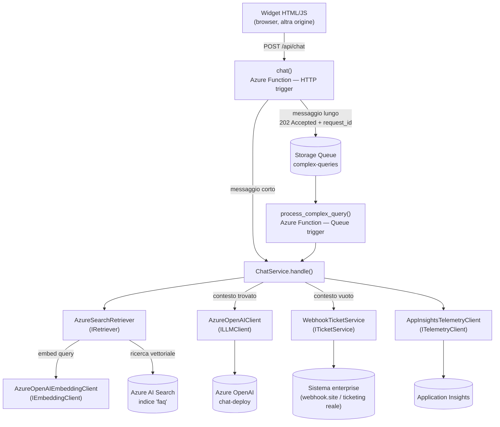

# Architettura del progetto e Glossario di ripasso

> Documento di sintesi, pensato per il ripasso pre-colloquio. Le guide `fase0`→`fase6` spiegano *come* costruire ogni pezzo passo-passo; questo file spiega *come tutto si tiene insieme* e raccoglie i termini che devi saper spiegare a voce, con definizioni brevi.

---

## 1. Cosa fa questo progetto, in una frase

Un chatbot di supporto tecnico su Azure Functions (Python) che risponde usando RAG (Azure AI Search + Azure OpenAI), traccia tutto su Application Insights, smista le richieste pesanti su una coda asincrona, ed escala a un ticket quando non trova informazioni sufficienti — invece di inventare una risposta.

## 2. Diagramma del flusso



Tre percorsi che convergono tutti sullo stesso `ChatService.handle()`, che non sa da dove viene stata chiamata (HTTP diretto o coda) né dove va a finire la risposta (utente diretto o polling):

1. **Sincrono normale**: widget → `chat()` → `ChatService` → retrieval + generazione → risposta `200`.
2. **Asincrono**: messaggio lungo → `chat()` pubblica su coda, risponde subito `202` → `process_complex_query()` la consuma in background → stessa `ChatService`.
3. **Escalation**: se il retriever non trova nulla di rilevante → `ChatService` apre un ticket invece di chiamare l'LLM a vuoto.

## 3. I livelli dell'architettura

```
domain/           →  Solo contratti (interfacce). Zero dipendenze da Azure, zero logica.
services/         →  Logica di business (ChatService). Dipende solo da domain/.
infrastructure/   →  Implementazioni concrete (Azure OpenAI, Azure AI Search, ecc). Dipendono da domain/.
function_app.py   →  "Composition root": assembla le implementazioni concrete e le inietta nel service.
widget/           →  Frontend statico, parla solo via HTTP con function_app.py.
knowledge-base/   →  Contenuto (le FAQ), non codice — l'input della pipeline RAG.
```

Regola che vale ovunque nel progetto: **le frecce delle dipendenze puntano sempre verso `domain/`**, mai verso `infrastructure/`. `ChatService` non ha mai un `import` che punta a un file dentro `infrastructure/`.

| File in `domain/interfaces.py` | Cosa astrae | Implementazione concreta in `infrastructure/` |
|---|---|---|
| `ILLMClient` | generare una risposta testuale | `AzureOpenAIClient` |
| `IEmbeddingClient` | trasformare testo in vettore | `AzureOpenAIEmbeddingClient` |
| `IRetriever` | recuperare contesto pertinente | `AzureSearchRetriever` |
| `ITelemetryClient` | tracciare eventi/eccezioni | `AppInsightsTelemetryClient` |
| `IQueuePublisher` | instradare lavoro asincrono | `AzureQueuePublisher` |
| `ITicketService` | aprire un ticket di escalation | `WebhookTicketService` |

Cinque interfacce, stesso schema ripetuto sei volte: è il punto da sottolineare al colloquio — non è un'idea applicata una volta per caso, è una **decisione architetturale consapevole e coerente**.

## 4. Percorso di una richiesta, passo passo

**Caso normale (domanda con risposta nella knowledge base):**
1. Il browser fa `POST /api/chat` con `{"message": "come resetto la password?"}`.
2. Il trigger HTTP (`@app.route`) attiva `chat()`.
3. Il messaggio è sotto `COMPLEXITY_THRESHOLD` → si va sincroni: `chat_service.handle(message)`.
4. `ChatService` chiama `retriever.retrieve(message)`: il retriever trasforma la domanda in un vettore (`embedding_client.embed`), interroga Azure AI Search con ricerca vettoriale, filtra i risultati sotto una soglia di score, ritorna i chunk pertinenti.
5. Il contesto non è vuoto → `ChatService` chiama `llm_client.complete(message, context)`: Azure OpenAI genera la risposta usando *solo* quel contesto (system prompt che lo istruisce esplicitamente).
6. Viene tracciato l'evento `llm_call_completed` con la durata.
7. `chat()` incapsula la risposta in JSON, status `200`.

**Caso escalation (nessun contesto rilevante trovato):**
4bis. Il retriever ritorna `[]` (nessun chunk sopra soglia) → `ChatService` traccia `retrieval_empty`, chiama `ticket_service.create_ticket(...)`, traccia `escalated_to_ticket`, e ritorna un messaggio che informa l'utente del ticket aperto — **senza mai chiamare l'LLM**.

**Caso messaggio complesso (asincrono):**
3bis. Il messaggio supera `COMPLEXITY_THRESHOLD` → `chat()` pubblica `{request_id, message}` sulla coda `complex-queries` tramite l'output binding, risponde subito `202 Accepted` con quel `request_id`.
4bis. In background, il trigger della coda attiva `process_complex_query()`, che chiama **lo stesso** `chat_service.handle(message)` — nessuna logica duplicata.

## 5. Principi SOLID applicati (dove si vedono nel codice)

| Principio | Dove | Come |
|---|---|---|
| **S**ingle Responsibility | `function_app.py` vs `services/chat_service.py` | La function fa solo da adapter HTTP/coda; tutta la logica di dominio vive in `ChatService` |
| **O**pen/Closed | Fase 5 (coda) | Aggiunto un canale di elaborazione intero senza toccare `ChatService` né l'endpoint esistente |
| **L**iskov Substitution | Ogni interfaccia | Qualunque implementazione di `ILLMClient` (eco finto, Azure OpenAI, domani un altro provider) è intercambiabile senza che `ChatService` se ne accorga |
| **I**nterface Segregation | `ILLMClient` vs `IEmbeddingClient` | Due interfacce separate anche se oggi le implementa la stessa risorsa Azure OpenAI — generare testo e generare vettori sono responsabilità diverse |
| **D**ependency Inversion | Tutto il progetto | `ChatService` dipende solo da astrazioni in `domain/`, mai da una classe concreta in `infrastructure/` |

Nota di giudizio architetturale (Fase 6): in un caso (Fase 5, nuovo canale) si è **esteso** il sistema senza toccare `ChatService`; in un altro (Fase 6, escalation) si è **modificato** `ChatService` di proposito, perché cambiava la regola di business stessa ("rispondere bene" ora include "sapere quando non rispondere"). Sapere distinguere i due casi è il tipo di ragionamento che un colloquio senior verifica.

---

## 6. Glossario — Azure, i fondamentali

| Termine | Spiegazione breve |
|---|---|
| **Resource Group** | Contenitore logico che raggruppa le risorse di un progetto — le vedi, gestisci e cancelli tutte insieme. Non è una risorsa a sé, solo un raggruppamento. |
| **Subscription** | Il contratto di fatturazione Azure sotto cui vivono le risorse — determina cosa puoi creare (es. Free Trial blocca alcune quote/piani) e chi paga. |
| **Region** | La zona geografica del datacenter dove vive una risorsa (es. `Sweden Central`, `Italy North`). Alcune feature/quote sono disponibili solo in certe region. |
| **Azure CLI** (`az`) | Strumento a riga di comando per creare/gestire risorse Azure senza portale, scriptabile (`az login`, `az functionapp create`, ecc). |
| **Azure Functions** | Servizio *serverless*: esegui codice (qui: Python) in risposta a un evento (**trigger**: HTTP, coda, timer...) senza gestire un server — scala automaticamente, paghi (di norma) a consumo. |
| **Trigger** | L'evento che fa partire una Function (es. `@app.route` = richiesta HTTP, `@app.queue_trigger` = nuovo messaggio in coda). |
| **Binding** | Collegamento dichiarativo tra una Function e una risorsa esterna, senza scrivere codice SDK a mano — **input binding** legge dati, **output binding** scrive (es. `@app.queue_output` scrive su una coda). |
| **Consumption Plan** | Piano di hosting per le Function dove paghi solo per le esecuzioni effettive (a differenza di un server sempre acceso). Su Free Trial è l'unico piano supportato (Flex Consumption non lo è). |
| **`host.json`** | Configurazione a livello di *host* dell'intera Function App (logging, extension bundle) — non segreti, va committato. |
| **`local.settings.json`** | Configurazione/segreti solo per lo sviluppo **locale** — mai committato (`.gitignore`), equivalente locale delle Application Settings del portale. |
| **`.funcignore`** | Come `.gitignore` ma per il deploy: dice quali file *non* impacchettare quando pubblichi la Function App. |
| **Managed Identity** | Un'identità Microsoft Entra ID "posseduta" automaticamente da una risorsa Azure (qui: la Function App), senza password/chiavi da gestire — usata per autenticarsi verso altre risorse Azure. |
| **Microsoft Entra ID** | Il servizio di identità e accesso di Azure (ex Azure Active Directory) — gestisce chi sei e cosa puoi fare. |
| **IAM / RBAC** (Role-Based Access Control) | Il meccanismo con cui assegni un **ruolo** (es. "Cognitive Services OpenAI User") a un'identità su una risorsa specifica — è quello che decide *chi può fare cosa*, indipendentemente dalla rete. |
| **`DefaultAzureCredential`** | Classe della libreria `azure-identity` che trova automaticamente quale identità usare per autenticarsi: Managed Identity quando gira su Azure, la tua utenza `az login` quando giri in locale — stesso codice, ambiente diverso. |
| **Azurite** | Emulatore locale dei servizi di Azure Storage (blob, code, tabelle) — permette di sviluppare Function che usano `AzureWebJobsStorage` senza un vero storage account. |
| **Blob Storage** | Servizio di archiviazione file/oggetti di Azure (qui usato per caricare i documenti della knowledge base prima dell'indicizzazione). |
| **Storage Queue** | Coda di messaggi semplice su Azure Storage — usata qui per l'elaborazione asincrona (`complex-queries`). Alternativa più "enterprise": **Service Bus**. |
| **Key Vault** | Servizio per custodire segreti (chiavi, password, certificati) in modo centralizzato e sicuro — nel progetto è predisposto ma non ancora necessario, perché tutto passa da Managed Identity. |
| **CORS** (Cross-Origin Resource Sharing) | Protezione **del browser**: blocca di default le chiamate `fetch` verso un'origine (dominio/porta) diversa da quella che ha servito la pagina, a meno che il server non dichiari esplicitamente di accettarle. |
| **PTU** (Provisioned Throughput Units) | Modalità di capacità *dedicata e prevedibile* per Azure OpenAI, alternativa al pay-per-token: garantisce un throughput fisso, utile con SLA di produzione — a differenza del pay-as-you-go che varia con la domanda. |

## 7. Glossario — Azure OpenAI e RAG

| Termine | Spiegazione breve |
|---|---|
| **Azure OpenAI** | Il servizio Azure che espone i modelli OpenAI (GPT, embedding) dietro l'infrastruttura/identità/compliance di Azure, invece che l'API OpenAI diretta. |
| **Deployment** | Un'istanza nominata di un modello dentro la tua risorsa Azure OpenAI (es. `chat-deploy` → `gpt-4.1-mini`) — il codice chiama il *nome del deployment*, non il nome del modello. |
| **Deployment type: Standard vs Global Standard** | "Standard" è legato alla capacità della risorsa/region specifica; "Global Standard" attinge a un pool di capacità globale — non tutti i modelli sono disponibili in entrambe le forme in ogni region. |
| **TPM** (Tokens Per Minute) | Il limite di velocità (quota) con cui puoi inviare token a un deployment — a 0 TPM il deployment esiste ma non risponde mai. |
| **System prompt** | L'istruzione data al modello *prima* della domanda dell'utente, che ne definisce il comportamento (qui: "rispondi solo con il contesto fornito, altrimenti dillo"). Meccanismo chiave per ridurre le allucinazioni. |
| **RAG** (Retrieval-Augmented Generation) | Pattern: prima di generare una risposta, recuperi da una base di conoscenza i pezzi di testo più pertinenti alla domanda e li passi al modello come contesto — il modello non "sa" le risposte a memoria, le legge nel prompt. |
| **Embedding** | Rappresentazione numerica (un vettore) di un testo che ne cattura il *significato* — testi semanticamente simili producono vettori "vicini" matematicamente. |
| **Chunk** | Un frammento di documento indicizzato come unità a sé stante nella pipeline RAG (qui: un file `.md` per argomento). |
| **Vector search** | Ricerca che confronta l'embedding della query con gli embedding indicizzati, per similarità matematica — capisce sinonimi/riformulazioni, non solo match esatti. |
| **Keyword search** | Ricerca testuale classica (tipo un "Ctrl+F" evoluto) — veloce ed esatta, ma non capisce sinonimi. |
| **Hybrid search** | Combina keyword + vector search nello stesso risultato — standard in produzione perché copre più casi (nomi di prodotto/codici esatti *e* domande riformulate). |
| **RRF** (Reciprocal Rank Fusion) | L'algoritmo che Azure AI Search usa per fondere i punteggi di keyword e vector search in un unico ranking — misura *la posizione relativa*, non la qualità assoluta di un match: non va usato per filtrare risultati irrilevanti (trappola da colloquio, vedi Fase 6). |
| **Cosine similarity** | La metrica di "vicinanza" tra due vettori usata nella vector search pura (0–1, interpretabile) — quella corretta da usare come soglia di rilevanza. |
| **Grounding** | Ancorare la risposta del modello a fonti/documenti verificabili, invece di lasciarlo generare da solo — è l'obiettivo del RAG. |
| **Allucinazione** | Quando un LLM genera un'informazione plausibile ma falsa/non verificabile, tipicamente perché non ha vincoli sufficienti (contesto assente + nessuna istruzione a dire "non lo so"). |
| **Skillset** (Azure AI Search) | La "ricetta" che dice al servizio come processare i documenti in ingresso: dividerli in chunk, generare gli embedding, ecc. |
| **Indexer** | Il processo che esegue lo skillset e scrive i risultati nell'indice, tenendolo sincronizzato con il data source. |
| **Data source** (Azure AI Search) | Il collegamento configurato verso l'origine dei documenti da indicizzare (qui: il container Blob Storage). |

## 8. Glossario — Osservabilità e async

| Termine | Spiegazione breve |
|---|---|
| **Application Insights** | Il servizio APM (Application Performance Monitoring) di Azure: raccoglie automaticamente richieste, dipendenze esterne ed eccezioni, più qualunque log/evento custom che gli inoltri. |
| **APM** | Categoria di strumenti per osservare le prestazioni e la salute di un'applicazione in produzione (latenza, errori, throughput). |
| **KQL** (Kusto Query Language) | Il linguaggio di query usato per interrogare i log/telemetria in Application Insights (tabelle come `traces`, `requests`, `exceptions`). |
| **`customDimensions`** | Il meccanismo con cui i log diventano campi *interrogabili* in Application Insights, invece di restare testo libero da cercare a occhio. |
| **Live Metrics** | Vista in tempo reale (pochi secondi di ritardo) delle richieste/eventi in Application Insights — utile per verificare subito dopo un deploy che tutto funzioni, invece di indovinare. |
| **Logging vs Telemetry** | Il logging è testo libero pensato per il debug umano; la telemetria è dati strutturati (eventi/metriche) pensati per essere aggregati e interrogati — Application Insights raccoglie entrambi. |
| **202 Accepted** | Status HTTP che significa "ho ricevuto la richiesta e la sto processando, non è ancora finita" — diverso da `200` (risposta già pronta nel corpo). |
| **Elaborazione asincrona / pattern coda** | Rispondere subito al chiamante e processare il lavoro vero in background via una coda — evita di tenere una richiesta HTTP bloccata per un'elaborazione lunga. |
| **Polling** | Tecnica in cui il client richiama periodicamente un endpoint per sapere se un lavoro asincrono (identificato da un `request_id`) è terminato. |

## 9. Glossario — Concetti di design del software

| Termine | Spiegazione breve |
|---|---|
| **Dependency Inversion (DI)** | Principio: sia il codice di alto livello (business logic) sia quello di basso livello (dettagli tecnici) dipendono da un'**astrazione**, non l'uno dall'altro — vedi la spiegazione dettagliata già fatta in questa conversazione. |
| **Dependency Injection** | La *tecnica* con cui si applica la Dependency Inversion in pratica: passare le dipendenze concrete dall'esterno (nel costruttore) invece di crearle dentro la classe. |
| **Composition root** | Il punto unico dell'applicazione dove le implementazioni concrete vengono create e "assemblate" iniettandole nei componenti che le richiedono (qui: `function_app.py`). |
| **`Protocol` (Python `typing`)** | Modo "strutturale" di definire un'interfaccia in Python: basta che una classe abbia i metodi giusti con la firma giusta, senza doverla ereditare esplicitamente (duck typing verificato staticamente). Usato per `ILLMClient`, `IRetriever`, `IEmbeddingClient`. |
| **`ABC` / `abstractmethod`** | Modo "nominale" di definire un'interfaccia: richiede ereditarietà esplicita (`class X(ABC)`) e forza l'implementazione dei metodi astratti a runtime. Usato per `ITelemetryClient`, `IQueuePublisher`, `ITicketService` — nel progetto convivono entrambi gli stili. |
| **SOLID** | I cinque principi di design (Single Responsibility, Open/Closed, Liskov Substitution, Interface Segregation, Dependency Inversion) — vedi tabella §5. |
| **Adapter** | Un componente che traduce un'interfaccia/formato in un altro senza contenere logica di business propria (qui: `function_app.py` fa da adapter tra il protocollo HTTP/coda di Azure Functions e `ChatService`). |
| **Stub / Mock** | Un'implementazione finta di un'interfaccia, usata per sviluppare/testare prima che l'implementazione reale sia pronta (es. `EchoLLMClient`, `EmptyRetriever` nelle prime fasi — oggi rimossi). |

---

## 10. Stato reale del progetto (implementato vs pianificato)

| Componente | Stato | Fase |
|---|---|---|
| Endpoint REST `/api/chat`, architettura a layer | ✅ Implementato | Fase 1 |
| Azure OpenAI (chat) con Managed Identity | ✅ Implementato | Fase 2 |
| RAG con Azure AI Search (hybrid → poi corretto a vector puro + soglia) | ✅ Implementato | Fase 3, corretto in Fase 6 |
| Application Insights + telemetria custom | ✅ Implementato | Fase 4 |
| Elaborazione asincrona via coda | ✅ Implementato | Fase 5 |
| Escalation a ticket + widget + CORS | ✅ Implementato (in lavorazione, non ancora committato) | Fase 6 |
| Cosmos DB per stato conversazione | ⏳ Non ancora implementato (`infrastructure/cosmos_conversation_store.py` è vuoto) | — |
| Gestione PTU / capacity planning reale | ⏳ Solo concettuale, mai gestito su una subscription reale | Fase 7 (annuncio) |
| Microsoft Copilot Studio | ⏳ Non trattato nel progetto | Nice to have (annuncio) |
| NLU / CLU | ⏳ Non trattato nel progetto | Nice to have (annuncio) |

## 11. Domande di ripasso rapido (raccolte dalle guide)

1. Se domani sostituisci Azure OpenAI con un altro provider LLM, quante righe di `chat_service.py` tocchi? *(zero — dipende solo da `ILLMClient`)*
2. Perché il budget alert su Azure va impostato *prima* di creare risorse costose, non dopo?
3. Come mitighi le allucinazioni in una pipeline RAG?
4. Perché ricerca ibrida e non solo vettoriale — e perché lo score RRF non va usato per filtrare la rilevanza?
5. Perché `IEmbeddingClient` è un'interfaccia separata da `ILLMClient`, anche se oggi le implementa la stessa risorsa?
6. Come diagnostichi un chatbot lento in produzione, usando Application Insights?
7. Perché in Fase 5 non hai toccato `ChatService` (OCP) ma in Fase 6 sì — cosa distingue i due casi?
8. Cos'è CORS e perché è una protezione del browser, non del server?
9. Perché l'autenticazione del progetto non usa mai una API key in chiaro?
